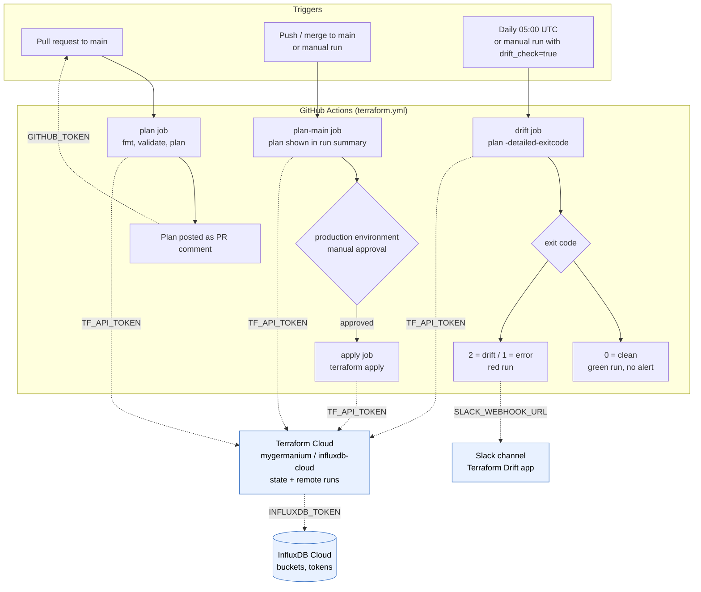
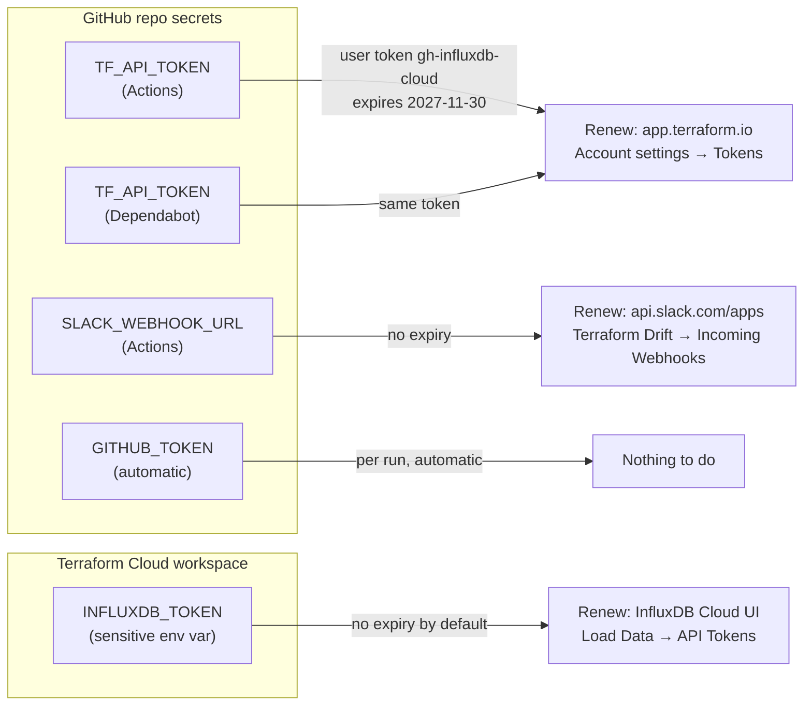

# Terraform workflow, drift detection and Slack alerts

Everything runs from one GitHub Actions workflow,
[`.github/workflows/terraform.yml`](../.github/workflows/terraform.yml).
Terraform itself executes in Terraform Cloud (organization `mygermanium`,
workspace `influxdb-cloud`); GitHub Actions only starts the runs and reports
the results.

## Triggers and jobs

| Trigger | Job(s) | What happens |
|---|---|---|
| Pull request to `main` | `plan` | `fmt`, `validate`, `plan`; the plan is posted as a PR comment |
| Push to `main` (merge) | `plan-main` → `apply` | Fresh plan shown in the run summary, then `apply` **waits for manual approval** in the `production` environment |
| `workflow_dispatch` | `plan-main` → `apply` | Same as a push to `main` |
| Daily at 05:00 UTC (`schedule`) | `drift` | Drift check, Slack alert on drift or error |
| `workflow_dispatch` with `drift_check=true` | `drift` | Drift check on demand: `gh workflow run terraform.yml -f drift_check=true` |

All jobs share the concurrency group `terraform-influxdb-cloud`, so a drift
check never runs at the same time as an apply; it waits in the queue instead.

## How drift is detected

The `drift` job runs:

```
terraform plan -input=false -no-color -detailed-exitcode
```

Terraform Cloud refreshes the real state of every resource in InfluxDB Cloud
and compares it with the code. The exit code decides the outcome:

| Exit code | Status | Result |
|---|---|---|
| `0` | `clean` | Real infrastructure matches the code. Run is green, no Slack message. |
| `2` | `drift` | Something was changed outside Terraform (e.g. in the InfluxDB UI) or code on `main` is not applied yet. Slack ⚠️ message, run fails (red). |
| `1` | `error` | The plan could not run (expired token, provider/API error, invalid code). Slack ❌ message, run fails (red). |

The plan output is also written to the run summary.

## Slack alert

On `drift` or `error`, the job posts to the Slack incoming webhook stored in
`SLACK_WEBHOOK_URL`. The message contains:

- the repository name and status (⚠️ drift / ❌ error),
- the `Plan: X to add, Y to change, Z to destroy` line (drift) or the first error line (error),
- the list of affected resource addresses (up to 20) or the error details,
- a link to the workflow run.

The run is then marked as failed, so drift is also visible in the Actions tab.
If `SLACK_WEBHOOK_URL` is missing or empty, the job logs a warning instead of
posting.

**Resolving drift:** either change the code to match reality (PR → merge →
approve), or re-apply the code to revert the manual change
(`gh workflow run terraform.yml`, then approve the `apply` job).

## Full workflow



Dashed arrows are authenticated calls, labelled with the secret they use.

## Secrets: where they live, expiry and renewal



| Secret | Stored in | Used by | Expires | How to renew |
|---|---|---|---|---|
| `TF_API_TOKEN` | GitHub → Settings → Secrets → **Actions** | `plan`, `plan-main`, `apply`, `drift` — authenticates to Terraform Cloud | Terraform Cloud user token `gh-influxdb-cloud`: **2027-11-30** | See [Renew `TF_API_TOKEN`](#renew-tf_api_token) |
| `TF_API_TOKEN` | GitHub → Settings → Secrets → **Dependabot** | `plan` on Dependabot PRs (Dependabot can't read Actions secrets) | Same token: **2027-11-30** | Same as above, set both copies |
| `SLACK_WEBHOOK_URL` | GitHub → Settings → Secrets → **Actions** | `drift` — posts alerts | Does not expire. Stops working if the webhook is removed, the Slack app is uninstalled or the channel is archived | See [Renew `SLACK_WEBHOOK_URL`](#renew-slack_webhook_url) |
| `INFLUXDB_TOKEN` | Terraform Cloud workspace `influxdb-cloud` → Variables (sensitive env var) | Terraform provider inside Terraform Cloud runs | InfluxDB Cloud API tokens don't expire unless deleted or set inactive | See [Renew `INFLUXDB_TOKEN`](#renew-influxdb_token) |
| `GITHUB_TOKEN` | Created by GitHub for each run | `plan` — posts the PR comment | End of each run | Nothing to do |

> When `TF_API_TOKEN` expires, every Terraform job fails to authenticate. The
> daily drift check then sends a ❌ *drift check failed* message to Slack, so an
> expired token is noticed the next morning. Set a calendar reminder about two
> weeks before **2027-11-30** to rotate it in time.

### Renew `TF_API_TOKEN`

1. Go to <https://app.terraform.io/app/settings/tokens> → **Create an API token**.
   Description `gh-influxdb-cloud`, expiration about 1 year.
2. In the repo directory, set both copies with the new value (paste at the prompt):
   ```
   gh secret set TF_API_TOKEN
   gh secret set TF_API_TOKEN --app dependabot
   ```
3. Verify: `gh workflow run terraform.yml -f drift_check=true` → the run is green.
4. Delete the old `gh-influxdb-cloud` token in Terraform Cloud.
5. Update the expiry date in this document.

### Renew `SLACK_WEBHOOK_URL`

1. Go to <https://api.slack.com/apps> → **Terraform Drift** → **Incoming Webhooks**
   → **Add New Webhook to Workspace** → choose the channel → **Allow**.
2. Copy the `https://hooks.slack.com/services/…` URL and run `gh secret set SLACK_WEBHOOK_URL`
   in a terminal (not via Claude Code's `!`, which can't prompt for input).
3. Remove the old webhook on the same Slack page.
4. Verify by causing a drift (e.g. edit a bucket in the InfluxDB UI) and running
   `gh workflow run terraform.yml -f drift_check=true`; revert the change afterwards.

The webhook URL is a credential: anyone who has it can post to the channel.
Never commit it to the repo.

### Renew `INFLUXDB_TOKEN`

1. In InfluxDB Cloud: **Load Data → API Tokens → Generate API Token → All Access API Token**.
2. In Terraform Cloud: workspace `influxdb-cloud` → **Variables** → edit
   `INFLUXDB_TOKEN` (environment variable, sensitive) → paste the new token.
3. Verify with a drift check (`gh workflow run terraform.yml -f drift_check=true`).
4. Delete the old token in InfluxDB Cloud.

## Approval gate

The `production` environment (GitHub → Settings → Environments) requires a
review from `germanium-git` before `apply` starts; self-review is allowed and
only the `main` branch can deploy. To approve: open the run →
**Review deployments** → `production` → **Approve and deploy**. Check the plan
in the run summary of `plan-main` first.
